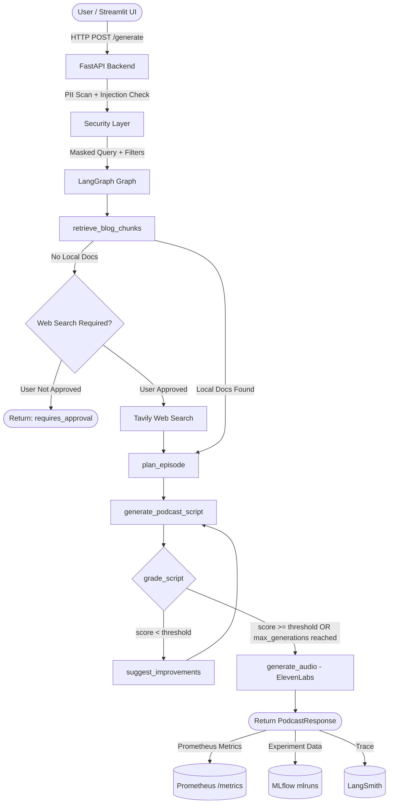

# 🎙️ Blog-to-Podcast Agent


**Blog-to-Podcast Agent** is a production-grade, multi-node agentic AI system that converts blog posts, PDFs, plain text, and live web URLs into fully narrated, high-quality podcast episodes.

It goes beyond a simple prompt chain — the system features a **self-evaluating, iteratively improving LangGraph pipeline** exposed through a **FastAPI backend**, a **Streamlit UI**, real-time **Prometheus metrics**, **MLflow experiment tracking**, **LangSmith tracing**, **PII detection**, **prompt injection guards**, and a **human-in-the-loop web search approval flow**.

---

## 🎯 Why This Project?

This project demonstrates how to build **production-grade agentic AI systems** — not prompt demos.

Key engineering goals:
- Deterministic, quality-gated LLM content generation
- Stateful multi-node agent orchestration with conditional branching
- Safe, bounded iteration loops with self-reflection
- Full observability stack: tracing, metrics, experiment logging
- Security layer: PII masking and prompt injection detection
- Clean separation of ingestion, reasoning, retrieval, and execution layers

The architecture mirrors real-world enterprise GenAI systems with attention to reliability, cost tracking, and auditability.

---

## 🧩 Agent Design Patterns

| Pattern | Implementation |
|---|---|
| **Cyclic Workflow** | LangGraph loop with bounded `max_generations` retries |
| **Reflection** | `grade_script` node critiques output; `suggest_improvements` feeds back into generation |
| **RAG** | ChromaDB vector store + hybrid retrieval (semantic + keyword + metadata filtering) |
| **Quality Gatekeeping** | Structured grader with `grade_score` threshold; rejects low-quality scripts |
| **Human-in-the-Loop** | Web search approval pause — user must confirm before external crawl |
| **State-Driven Orchestration** | Explicit typed `PodcastState` with conditional edges via LangGraph |
| **Plan-then-Execute** | `plan_episode` node creates a structured outline before script generation |

---

## 🏗️ Architecture

### Full Pipeline Flow



### Component Map

```
Blog-to-Podcast-Agent/
├── api/
│   ├── main.py           # FastAPI app, CORS, Prometheus instrumentator, lifespan
│   ├── routes.py         # Endpoints: /generate, /health, /metrics, /audio/{file}
│   ├── services.py       # Business logic: LangGraph invocation, MLflow run tracking
│   ├── models.py         # Pydantic request/response schemas (FilterOptions, PodcastResponse)
│   ├── metrics.py        # Prometheus counters/histograms (cost, tokens, chunks, PII, etc.)
│   └── security.py       # PII masking (Presidio) + prompt injection detection
│
├── graph/
│   ├── graph.py          # LangGraph state machine: nodes + conditional edges
│   ├── state.py          # Typed PodcastState TypedDict
│   ├── nodes/
│   │   ├── retrieve_blog_chunks.py   # Hybrid RAG: semantic + BM25 + metadata filters
│   │   ├── plan_episode.py           # Structured episode outline generation
│   │   ├── generate_podcast_script.py# Script writing with improvement context
│   │   ├── grade_script.py           # Structured quality grading (0.0–1.0 score)
│   │   ├── suggest_improvements.py   # Reflection: generates targeted improvement hints
│   │   └── generate_audio.py         # ElevenLabs TTS synthesis
│   ├── chains/
│   │   ├── planner_chain.py          # LLM chain for episode planning
│   │   ├── podcast_script_chain.py   # LLM chain for script generation
│   │   ├── script_grader_chain.py    # Structured grading chain (JSON output)
│   │   ├── improvements_chain.py     # Improvement suggestion chain
│   │   └── retriever_chain.py        # Context retrieval + formatting chain
│   ├── prompts/
│   │   ├── planner.txt               # Active planner system prompt (versioned via hash)
│   │   ├── writer.txt                # Active writer system prompt
│   │   ├── grader.txt                # Active grader system prompt
│   │   ├── improvements.txt          # Active improvements system prompt
│   │   ├── retriever.txt             # Active retriever system prompt
│   │   ├── loader.py                 # Prompt versioning: SHA-256 hash tracking
│   │   └── old_versioning_format/    # Archived previous prompt versions
│   └── tools/
│       ├── vectorstore_tool.py       # ChromaDB search (semantic + metadata filters)
│       └── web_search_tool.py        # Tavily web search integration
│
├── ingestion/
│   └── loaders.py        # PDF, TXT, Markdown, URL loaders + chunking + embedding
│
├── frontend/
│   ├── app.py            # Streamlit UI: podcast generator + analytics + sidebar config
│   └── utils.py          # API client helpers for FastAPI communication
│
├── outputs/
│   └── audio/            # Generated .mp3 podcast files
│
├── tests/                # Test suite (pytest)
├── Dockerfile.api         # FastAPI container
├── Dockerfile.frontend    # Streamlit container
├── docker-compose.yml     # Full multi-service orchestration
└── pyproject.toml        # Dependencies (Poetry)
```

---

## ✨ Key Features

### 🔁 Agentic Pipeline
- **6-node LangGraph workflow**: retrieve → plan → generate → grade → improve → audio
- **Self-reflection loop**: The agent critiques its own script and regenerates if quality is below threshold
- **Bounded retries**: `max_generations` cap prevents infinite loops

### 📥 Smart Multi-Source Ingestion
- Supports **PDF, TXT, Markdown, and live URLs**
- Crawls web content via **Tavily Crawl** for clean extraction
- Chunks and embeds content into **ChromaDB** with rich metadata

### 🔍 Hybrid RAG Retrieval
- Combines **semantic similarity search** (ChromaDB) + **BM25 keyword search**
- **Metadata filtering**: filter by source URL prefix, source type (pdf/url/text)
- Each retrieved chunk carries full provenance metadata (source, page, chunk_id, source_type)

### 🌐 Human-in-the-Loop Web Search
- If local documents are insufficient, the agent **pauses and asks the user** for approval before crawling the internet
- Web search is performed via **Tavily Search API** only after explicit user consent

### 🔒 Security Layer
- **PII masking**: Detects and redacts personal information (names, emails, phone numbers) from queries before they enter the pipeline
- **Prompt injection detection**: Flags adversarial inputs attempting to override system behavior
- PII metadata is logged in every LangSmith trace and Prometheus metric

### 📊 Full Observability Stack
- **Prometheus metrics** exposed at `/metrics`:
  - `requests_total` (by status)
  - `pipeline_duration_seconds`
  - `llm_cost_usd_total` (by model)
  - `tokens_used_total` (prompt/completion split)
  - `scripts_accepted_total`
  - `script_word_count`
  - `retrieval_docs_found`
  - `pii_detections_total` (by entity type)
- **MLflow experiment tracking** (local `mlruns/`): logs params, metrics, generated scripts as artifacts
- **LangSmith tracing**: every graph run is traced with prompt version metadata, cost, and PII flags

### 🗂️ Prompt Versioning
- Every prompt file is tracked by its **SHA-256 hash**
- Hash is included in every LangSmith trace and MLflow run — enabling regression detection
- Old prompt versions archived in `graph/prompts/old_versioning_format/`

### 🖥️ Streamlit UI
- **Podcast Generator** tab: upload documents, crawl URLs, enter query, set filters, generate podcast
- **Analytics & Observability** tab: live Prometheus metrics dashboard
- Sidebar: API status indicator, Chroma chunk viewer, max generations slider, user profile

---

## 🛠️ Tech Stack

| Layer | Technology |
|---|---|
| **Orchestration** | LangGraph + LangChain |
| **LLM** | Groq (llama-3.1-8b-instant) |
| **Embeddings** | Ollama (nomic-embed-text) |
| **Vector Store** | ChromaDB |
| **TTS / Audio** | ElevenLabs (eleven_multilingual_v2) |
| **Web Search** | Tavily Search + Tavily Crawl |
| **Backend API** | FastAPI + Uvicorn |
| **Frontend** | Streamlit |
| **Tracing** | LangSmith |
| **Metrics** | Prometheus + prometheus-fastapi-instrumentator |
| **Experiment Tracking** | MLflow |
| **Security** | Presidio (PII), custom injection guard |
| **Dependency Management** | Poetry |
| **Containerisation** | Docker + Docker Compose |

---

## 🚀 Installation & Setup

### 1. Prerequisites
- Python 3.11+
- [Ollama](https://ollama.com) installed locally (for embeddings)

```bash
# Pull the required embedding model
ollama pull nomic-embed-text
```

### 2. Clone and Install

```bash
git clone https://github.com/dR-ViBE/Blog-to-Podcast-Agent.git
cd Blog-to-Podcast-Agent
pip install poetry
poetry install
```

### 3. Environment Configuration

Create a `.env` file in the project root:

```ini
# LLM & Inference
GROQ_API_KEY=your_groq_api_key

# Web Search & Crawling
TAVILY_API_KEY=your_tavily_api_key

# Text-to-Speech
ELEVENLABS_API_KEY=your_elevenlabs_api_key
ELEVENLABS_VOICE_ID=your_voice_id

# Tracing (optional)
LANGCHAIN_API_KEY=your_langsmith_api_key
LANGCHAIN_PROJECT=podcast-agent
LANGCHAIN_TRACING_V2=true

# App Config
APP_NAME=blog-to-podcast-agent
APP_VERSION=1.0.0
ENVIRONMENT=development
```

---

## 💻 Usage

### Option A — FastAPI + Streamlit (Recommended)

```bash
# Terminal 1: Start the backend
uvicorn api.main:app --host 0.0.0.0 --port 8000

# Terminal 2: Start the frontend
streamlit run frontend/app.py
```

- **Streamlit UI:** http://localhost:8501
- **API Docs (Swagger):** http://localhost:8000/docs
- **Health Check:** http://localhost:8000/health
- **Prometheus Metrics:** http://localhost:8000/metrics

### Option B — Docker Compose

```bash
docker-compose up --build
```

### Option C — Script (Legacy)

```bash
# Ingest content first
poetry run python ingestion.py

# Run the agent directly
poetry run python main.py
```

---

## 📡 API Endpoints

| Method | Endpoint | Description |
|---|---|---|
| `POST` | `/generate` | Run the full podcast pipeline |
| `POST` | `/generate/approved` | Run pipeline with web search pre-approved |
| `POST` | `/ingest` | Ingest a document or URL into ChromaDB |
| `GET` | `/health` | Health check |
| `GET` | `/metrics` | Prometheus metrics scrape endpoint |
| `GET` | `/audio/{filename}` | Stream a generated audio file |

---

## 🔄 What's New (Phase 1)

Previously the project was a local CLI tool. Phase 1 upgraded it to a full production-grade service:

| Feature | Status |
|---|---|
| FastAPI REST backend | ✅ |
| Streamlit web UI | ✅ |
| Prometheus observability | ✅ |
| MLflow experiment tracking | ✅ |
| LangSmith tracing with prompt version metadata | ✅ |
| PII masking + prompt injection detection | ✅ |
| Human-in-the-loop web search approval | ✅ |
| Hybrid RAG (semantic + BM25 + metadata filters) | ✅ |
| Prompt versioning via SHA-256 hashing | ✅ |
| Cost + token tracking per run | ✅ |
| Multi-source ingestion (PDF, TXT, MD, URL) | ✅ |
| Docker Compose multi-service deployment | ✅ |

---

## 🚧 Planned Enhancements

- Persistent Prometheus metrics across restarts (external Prometheus server)
- Multi-voice / speaker diarization podcasts
- Batch multi-blog processing
- AWS Elastic Beanstalk deployment
- Grafana dashboard for metrics visualisation
- Streaming audio generation (real-time output)
